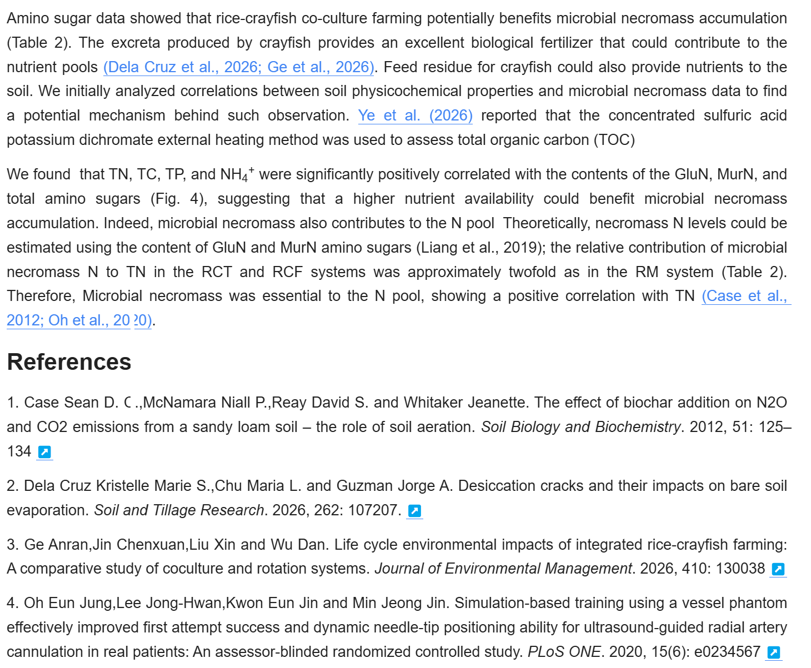
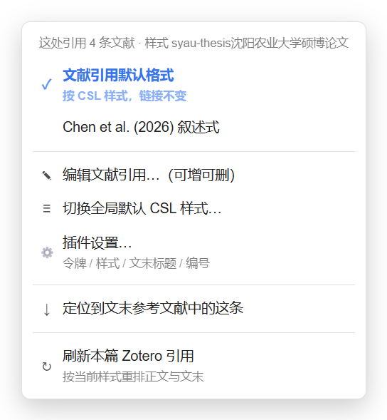

# Zotero Cite（siyuan-plugin-zotero-cite）v1.2.27

**简体中文** | [English](./README_en.md)


## 1 一句话概括

在思源里插入 Zotero 文献引用，正文文本和文末参考文献表都由 Zotero 已装的 CSL 样式直接渲染，插完就是排好的学术稿。

## 2 主要功能



正文那行引用和文末的「参考文献」都由 Zotero 的 CSL 样式直接渲染：换一套样式，两处一起重排，不用手改一个字。

| 功能 | 说明 |
|---|---|
| 2.1 一步插入 | 在 Zotero 选中文献（可多选），回思源点一下入口即插入，正文与文末同时更新，不弹窗 |
| 2.2 文本严格按 CSL | 正文长什么样、多条怎么合并、要不要带 `[n]`，全部由 Zotero 当前样式决定（APA、Nature、IEEE、GB/T 7714、ACS、期刊自定义样式均可） |
| 2.3 两种形态、逐条混用 | 默认形态（父条目/作者年/数字）+ 叙述式 `Chen et al. (2021)`；同一篇里可混用，也支持叠加 `Chen et al. (2021) [1]` |
| 2.4 右键改已有引用 | 切换形态、增删该处文献、切换全文 CSL 样式、定位到文末对应条目、刷新本篇引用 |
| 2.5 文末文献表自动生成 | 顺序按样式（作者年=字母序，数字式=引用序）；编号默认跟随 CSL 样式，可在设置里关掉或换成自定义写法；换样式后自动重排 |
| 2.6 点击回跳 Zotero | 单击引用即在 Zotero 选中该文献；多条目合并的引用会同时选中全部 |
| 2.7 只认父条目 | 在 Zotero 里选中 PDF 或批注，自动上溯到所属文献；独立笔记/独立附件不出现 |
| 2.8 可撤销 | 每篇文档 20 步，样式切换也能回滚 |

## 3 它解决了思源的哪些问题

| 思源原生 | 本插件 |
|---|---|
| 3.1 没有「文献引用」这个东西，只有块引用和普通超链接 | 引用是带 `zotero://` 的链接，但显示文本由 CSL 渲染，等于把 Zotero 的引用引擎搬进思源 |
| 3.2 文末参考文献得从 Zotero 复制出来手贴，换样式全部重排 | 文末表自动生成，换 CSL 样式后全文 + 文末一起重排 |
| 3.3 正文引用格式（作者年 / 数字）靠手打，改一处要顺着改全文编号 | 编号与作者年由 CSL 按引用顺序自动分配，增删引用后正文与文末自动重排 |
| 3.4 正文引用与文末条目没有对应关系，删文献要两头对 | 同一条文献在正文与文末共用 itemKey，删掉正文引用后重排，文末自动收掉 |
| 3.5 想查某句话出自哪篇，得自己回 Zotero 找 | 点引用直接跳 Zotero 并选中该条目，多条目一起选 |
| 3.6 中英文期刊、学位论文模板各异，手工排极易出错 | CSL 样式库几千种随取随用，导入自定义 CSL 同样生效 |

## 4 和其他思源文献插件比

以下仅依据各插件公开说明整理，**未逐一实测**，具体以对方文档为准。

| 对比项 | 本插件 Zotero Cite | 文献引用（WingDr/siyuan-plugin-citation） | 论文管理（fu1fan/siyuan-paper-manager） |
|---|---|---|---|
| 4.1 核心定位 | 正文引用 + 文末文献表，按 CSL 渲染 | 文献笔记库 + 引用链接，可导出 Word/LaTeX | 原生数据库管理文献库，导出引用文本 |
| 4.2 是否需先建文献笔记 | 不需要 | 需要（引用指向库里的文献笔记文档） | 不需要（用原生数据库存元数据） |
| 4.3 引用渲染方式 | 交给 Zotero 的 CSL 引擎，正文与文末同源 | 按样式生成锚文本，多种样式可选 | 以「导出引用」为主，正文引用需自行粘贴 |
| 4.4 文末参考文献表 | 自动生成并随样式重排 | 依赖文献笔记库结构 | 提供导出，不维护文末表 |
| 4.5 数据来源 | Zotero 10 + Debug Bridge | BibTeX / CSL-JSON / Better BibTeX / Debug Bridge / Web API 五种 | Zotero Connector 接收 + 本地 PDF 识别 |
| 4.6 依赖门槛 | 必须装 Zotero 与 Debug Bridge | 可只用本地 BibTeX 文件 | 可不装 Zotero，PDF 元数据靠联网识别 |
| 4.7 适合谁 | 用 Zotero 管文献、要投稿级排版 | 想在思源里维护整库文献笔记 | 想在思源里当文献库 + 翻译 PDF |

取舍一句话：**文献本来就在 Zotero 里、只要正文和文末排版对**，本插件最省事；**想在思源内部建文献卡片、导出 Word/LaTeX**，那两款更合适。

## 5 主要依赖与配置

### 5.1 依赖（缺一不可）

| 依赖 | 版本 | 说明 |
|---|---|---|
| Zotero | **10** | 插件通过 Zotero 内部的 Debug Bridge 执行代码，不直接读数据库文件 |
| Zotero Debug Bridge | **1.2** | Zotero 插件，提供 `127.0.0.1:23119/debug-bridge/execute` 接口 |
| 思源笔记 | 3.1.0+ | 仅桌面端（`frontends: desktop`） |

没装 Debug Bridge 时，23119 端口上不存在该端点，插件所有请求都会失败。

### 5.2 首次配置

图文步骤见 <http://ttchen.w1.luyouxia.net/20260915211141-favpvyz-site/20260915211232-qh8ikcb.html>。

1. 下载 Debug Bridge **1.2** 的 xpi（别用更旧的包）
2. Zotero → 工具 → 插件，把 xpi 直接拖进窗口
3. 重启 Zotero
4. Zotero → 工具 → 开发者 → Run JavaScript，执行：

   ```js
   Zotero.Prefs.set("extensions.zotero.debug-bridge.token", "CTT", true);
   ```

   `"CTT"` 换成你自己的令牌
5. 思源 → 设置 → 集市 → 已下载 → 插件 → Zotero 引用 → 设置，把同一令牌填进「访问令牌」
6. 点「测试连接」，看到 `连接正常：Zotero 10.x，库 ID 1` 即通

换电脑要重做第 1–5 步（令牌存在 Zotero 的 prefs.js，不随思源同步）。

### 5.3 设置项

| 项 | 默认 | 说明 |
|---|---|---|
| Bridge 地址 | `http://127.0.0.1:23119/debug-bridge/execute` | 一般不用改 |
| 访问令牌 | 空 | 5.2 第 4 步设置的 token |
| 默认引用形态 | 文献引用默认格式 | 只影响新插入的引用；已有引用按自己链接里的 `?f=` 走 |
| CSL 样式 | 当前使用样式 | 可手填样式 URL |
| 从 Zotero 已装样式里选一个… | — | 打开样式选择器，搜索后一键切换，全文重排 |
| 文末标题 | 参考文献 | 生成文末表用的标题，必须与文中标题一致 |
| 引用带链接 | 开 | 关掉只留纯文本，点击跳转与右键菜单失效 |

## 6 触发词与快捷键

| 入口/命令 | 触发方式 | 快捷键 |
|---|---|---|
| 6.1 插入引用（主入口） | 编辑器里敲 `/zotero` 回车 | 未绑定，可在 设置 → 快捷键 → 插件 自设 |
| 6.2 插入引用 | 顶栏红色 Z 图标 | — |
| 6.3 插入引用 | 命令面板「插入 Zotero 文献引用」 | 未绑定 |
| 6.4 重排全文引用 | 命令面板「重排全文 Zotero 引用」 | 未绑定 |
| 6.5 切换光标处引用形态 | 命令面板「切换光标处引用的形态」 | 未绑定 |
| 6.6 撤销上一次引用操作 | 命令面板「撤销上一次 Zotero 引用操作」 | `Ctrl+Alt+Z`（macOS：`⌥⌘Z`） |
| 6.7 右键 · 文献引用默认格式 | 在正文引用上右键 → 第一项 | — |
| 6.8 右键 · 叙述式（`Chen et al. (2026)`） | 在正文引用上右键 → 第二项（数字式样式下置灰） | — |
| 6.9 右键 · 编辑文献引用…（可增可删） | 在正文引用上右键 → 第三项，打开编辑窗口 | — |
| 6.10 右键 · 切换全局默认 CSL 样式… | 在正文引用上右键 → 第四项，打开样式选择器 | — |
| 6.11 右键 · 定位到文末参考文献中的这条 | 在正文引用上右键 → 第五项，滚到文末并高亮 1.9 秒 | — |
| 6.12 右键 · 刷新本篇 Zotero 引用 | 在正文引用上右键 → 第六项，按当前样式重排本篇正文引用与文末 | — |
| 6.13 块内右键 · 插入 Zotero 文献引用 | 在任意段落内部右键 → 「插入 Zotero 文献引用」，用 Zotero 当前选中项直接插入 | — |

右键菜单只作用于**正文引用**和它所属的那一条引用；点文末参考文献条目上的 `[↗]` 不弹菜单（那是回跳 Zotero 的入口）。菜单没有默认快捷键，需要的话可在 设置 → 快捷键 → 插件 里给对应命令绑定。

## 7 用法与详细操作步骤

### 7.1 插入一条引用

1. 在 Zotero 里选中文献（可多选，合起来成为一条引用）
2. 回到思源，光标放到要插入的位置
3. 任选一个入口（三者行为完全一样）：
   - 敲 `/zotero` 回车
   - 点顶栏红色 Z 图标
   - 命令面板搜「插入 Zotero 文献引用」
4. 正文出现引用，文末自动生成本条文献

Zotero 里没选中条目时只提示一句，不弹窗。

### 7.2 改已有引用（右键 5 项）

在正文引用上右键，弹出的菜单长这样：



| 菜单项 | 作用 |
|---|---|
| 文献引用默认格式 | 恢复成样式自己的写法，只影响这一处 |
| `Chen et al. (2026)` 叙述式 | 改成叙述式，只影响这一处；数字式样式下置灰 |
| 编辑文献引用…（可增可删） | 列出这处引用的所有条目，取消勾选即删；可从 Zotero 当前选中追加，或按关键词搜索添加 |
| 切换全局默认 CSL 样式… | 读 Zotero 已装样式，搜索后应用，全文按新样式重排 |
| 定位到文末参考文献中的这条 | 滚到文末对应条目并高亮 1.9 秒，多条会全部标出 |
| 刷新本篇 Zotero 引用 | 按当前 CSL 样式重排本篇：正文全部引用 + 文末列表，等于在右键里直接执行一次「重排全文」 |

点「编辑文献引用…」打开的是这个窗口，取消勾选即从这条引用里移除；序号只给保留下来的条目排，取消后自动重排：


- 单击引用 = 跳 Zotero（多条目同时选中）
- 删除整处引用：直接删掉正文那段文本，或「编辑文献引用」里取消全部勾选

### 7.3 撤销

插件写入走内核 API，不经过思源前端撤销栈，普通 `Ctrl+Z` 管不到重排与样式切换。

1. 命令面板「撤销上一次 Zotero 引用操作」或 `Ctrl+Alt+Z`
2. 每篇文档 20 步，一步 = 一次完整操作
3. 撤销会连 CSL 样式一起回滚并重排文末
4. 只插入引用这一步走 `protyle.insert`，仍在思源自己的撤销栈里，普通 `Ctrl+Z` 可撤

### 7.4 引用的本质

正文引用就是一个 markdown 链接：

```
[(Bordoloi et al., 2019)](zotero://select/library/items/UAPYI8NA?f=csl)
```

1. 链接是唯一数据源，重排时从正文回收顺序
2. `?f=` 是这处引用的形态（`csl` / `narr`），逐条独立
3. 多条目：`items/KEY1?zkeys=KEY1,KEY2&f=csl`
4. 文末条目链接带 `?bib=1`，重排时跳过，不会把已删文献「复活」

## 8 现有不足

1. **强依赖 Zotero + Debug Bridge**：没装就完全不能用，不是自包含工具
2. **只支持 Zotero**：EndNote、Mendeley、NoteExpress、PubMed 直连都不支持
3. **仅桌面端**：依赖本机 23119 端口，网页版 / 移动端用不了
4. **文末重建会清空标题之后的块**：别在「参考文献」标题后面写正文，每次重排都会被删
5. **撤销是独立栈**：`Ctrl+Z` 只能撤「插入」这一步，重排与样式切换必须用插件自己的撤销命令
6. **叙述式仅限作者年样式**：IEEE、GB/T 顺序编码这类数字样式没有叙述式概念
7. **文末编号默认跟随 CSL 样式**：数字式样式会带 `[1]` / `1.`（`1. ` 会写成转义形式防止被当成有序列表），作者年样式本来就没有编号。设置里可改为「不显示编号」或自定义模板（`{n}` 为序号占位）。投稿前请按期刊要求核对
8. **换机需重配**：Debug Bridge 与 token 都要重装重填
9. **性能随文档规模下降**：引文很多的长文档，一次重排逐块读写，会明显停顿。**建议单篇文档不超过 10 万字、引用不超过 300 条**

---

## 9 技术实现（附录）

| 环节 | 做法 |
|---|---|
| 与 Zotero 通信 | 直连本机 `http://127.0.0.1:23119/debug-bridge/execute`，把一小段 JS 送进 Zotero 执行，取回条目元数据、已装 CSL 样式、渲染好的引文串。没有中间进程，也没有中转服务 |
| 引用落地形态 | 一条普通 markdown 链接 `[(Bordoloi et al., 2019)](zotero://select/library/items/UAPYI8NA?f=csl)`，链接本身是唯一数据源（详见 7.4） |
| 正文渲染 | 交给 Zotero 里已装的 CSL 样式渲染，正文串与文末串同源；换样式时两处一起重排 |
| 文末列表 | 定位「参考文献」标题，重建标题之后的区块；条目链接带 `?bib=1`，重排时跳过，已删文献不会复活 |
| 撤销 | 每篇文档独立栈、20 步，写回走内核 `/api/transactions` |
| 运行环境 | 思源桌面端渲染进程（有 Node）；网页版与移动端没有 23119 端口，用不了 |
| 代码结构 | 单文件 `index.js`：插件主类 + 三个 Dialog + 右键菜单 + 设置页；`index.css` 只负责版式，颜色全部取思源 CSS 变量，浅色 / 深色主题自动跟随 |

## 10 构建与发布（开发者）

```
node --check index.js      # 语法自查
bash scripts/preflight.sh  # 发版体检：清单、版本号、必需文件、图标、包结构
bash scripts/build.sh      # 产出 package.zip
bash scripts/release.sh    # 需要 GH_TOKEN，建 Release 并上传 package.zip
```

- `package.zip` 里的文件**必须直接在 zip 根层**，套一层同名目录会导致集市安装后不加载
- `plugin.json` 的 `version`、README 标题里的版本号、GitHub Release 的 tag 三者保持一致
- 发布：Release 的 tag 写版本号（如 `v1.2.26`），附件放 `package.zip`
- 上架：集市仓库 `siyuan-note/bazaar` 的 `plugins.txt` 里已有本仓库，Action 会按 `plugin.json` 的版本重新生成索引，日常发版不需要再提 PR

## 11 许可

MIT License © 2026 ttChen

---

## 版本史

| 版本 | 日期 | 主要变化 |
|---|---|---|
| 1.2.27 | 2026-11-03 | 作者名统一为 ttChen（plugin.json / package.json / LICENSE / README） |
| 1.2.26 | 2026-11-03 | 三个对话框版式重做：说明条 + 卡片列表 + 序号徽标 + 自绘复选框，左右留白，深色主题跟随；补集市封面与 README 配图 |
| 1.2.25 | 2026-11-01 | 点击监听收窄，不再吞掉 Zotero 批注回跳链接 |
| 1.2.24 | 2026-11-01 | 300 条引用的性能优化（指纹 / 事务删除 / 并发预读），相邻引用自动合并 |
| 1.2.19 | 2026-11-01 | 切换形态只改一处、文末编号交回 CSL、右键加「刷新本篇」 |
| 1.2.14 | 2026-11-01 | 插入改为直接用 Zotero 当前选中项，不再弹窗 |
| 1.2.11 | 2026-10-31 | 新增 `/zotero` 斜杠命令入口 |
| 1.2.10 | 2026-10-31 | 首个发布版：经 Zotero Debug Bridge 插入 CSL 引用与参考文献表 |
