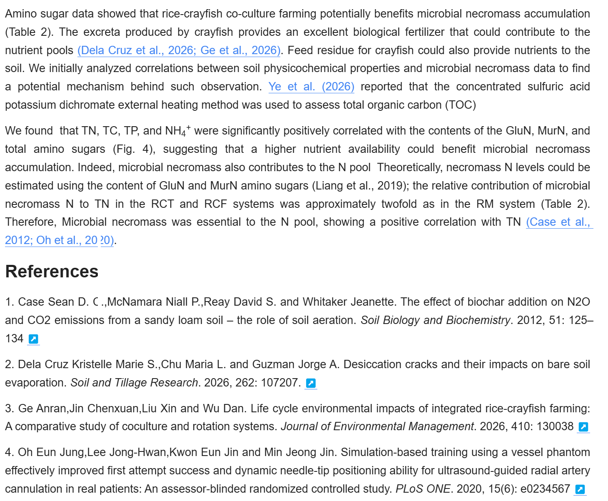
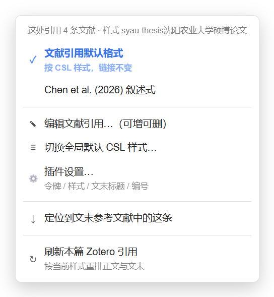

# Zotero Cite (siyuan-plugin-zotero-cite) v1.2.35

**English** | [简体中文](./README.md)


## 1 In one sentence

Insert Zotero citations into SiYuan — both the in-text citation and the bibliography are rendered by the CSL style you already use in Zotero, so what you get is submission-ready text.

## 2 What it does



Both the in-text citations — merged as `(Dela Cruz et al., 2026; Ge et al., 2026)`, narrative as `Ye et al. (2026)` — and the References list at the bottom are rendered directly by the CSL style active in Zotero. Switch styles once and both sides are re-rendered with no manual editing; the ↗ next to each entry jumps back to Zotero.

| Feature | Detail |
|---|---|
| 2.1 One-click insert | Select items in Zotero (multi-select allowed), click once in SiYuan, both the text and the bibliography update. No dialog |
| 2.2 Text follows CSL exactly | How the citation reads, how multiple items are joined, whether `[n]` appears — all decided by the active Zotero style (APA, Nature, IEEE, GB/T 7714, ACS, journal-specific styles) |
| 2.3 Two forms, mixable per citation | Default form (parent item / author-date / numeric) plus narrative `Chen et al. (2021)`; you can mix them in one document and even stack them as `Chen et al. (2021) [1]` |
| 2.4 Edit existing citations | Switch form, add or remove references of that citation, change the document-wide CSL style, jump to the matching bibliography entry, refresh the document, or open the plugin settings right from the menu |
| 2.5 Bibliography maintained automatically | Order follows the style (alphabetical for author-date, citation order for numeric); entry numbering follows the CSL style by default, and can be turned off or replaced with a custom template; re-rendered when the style changes; rebuilt in place, so an appendix written after the list never gets swallowed into the bibliography |
| 2.6 Click to jump back to Zotero | Clicking a citation selects that item in Zotero; multi-item citations select all of them |
| 2.7 Parent items only | Selecting a PDF or an annotation in Zotero resolves to its parent item; standalone notes and attachments never appear |
| 2.8 Undo | 20 steps per document, style switches included |
| 2.9 Citation snapshot fallback | The trimmed CSL data of every reference plus its last rendered text are stored in a document attribute (~0.3 KB each). When an item is gone from Zotero, or missing on this machine after a sync, re-rendering restores the previous text and tells you exactly which keys it could not find |
| 2.10 Only the blocks that changed | Blocks whose content is unchanged are not written at all — the same holds for citations inside lists, tables and headings; ten consecutive runs leave both content and block attributes untouched |

## 3 Problems it solves in SiYuan

| Native SiYuan | With this plugin |
|---|---|
| 3.1 There is no citation concept at all — only block references and plain hyperlinks | A citation is a `zotero://` link whose visible text is rendered by CSL, effectively bringing Zotero's citation engine into SiYuan |
| 3.2 The bibliography has to be pasted in from Zotero by hand, and rebuilt whenever the style changes | The bibliography is generated automatically and re-rendered together with the body when the style changes |
| 3.3 In-text formatting (author-date vs. numeric) is typed manually; changing one citation means fixing every number | Numbers and author-date strings are assigned by CSL in citation order; body and bibliography re-render automatically after citations are added or removed |
| 3.4 In-text citations and bibliography entries have no link to each other, so removing a reference means fixing both ends | Both ends share the same itemKey; delete an in-text citation, re-render, and the bibliography entry disappears |
| 3.5 Finding which paper a sentence came from means digging through Zotero | Click the citation to jump to Zotero with the item selected — all items for a multi-item citation |
| 3.6 Journal and thesis templates differ wildly; hand-formatting is error-prone | Thousands of CSL styles are available instantly, and custom CSL files work too |
| 3.7 A reference deleted from Zotero, or missing on this machine after a sync, silently changes the text | The text from the last successful render is kept in a document attribute and used as a fallback; the notification names every key that is no longer in Zotero (see 7.5) |

## 4 How it compares

Based only on each plugin's public documentation. **Not tested side by side** — check their docs for authoritative detail.

| | Zotero Cite (this plugin) | 文献引用 (WingDr/siyuan-plugin-citation) | 论文管理 (fu1fan/siyuan-paper-manager) |
|---|---|---|---|
| 4.1 Focus | In-text citations + bibliography, rendered by CSL | Literature-note library + citation links, Word/LaTeX export | Native-database paper library, citation export |
| 4.2 Literature notes required first | No | Yes — citations point at note documents in a library | No — metadata lives in a native database |
| 4.3 Rendering | Handed to Zotero's CSL engine; body and bibliography share one source | Anchor text generated from templates, several styles | Mostly "export a citation string"; you paste it into the body |
| 4.4 Bibliography | Generated and re-rendered with the style | Depends on the literature-note library structure | Export only; no bibliography maintenance |
| 4.5 Data source | Zotero 10 + ZBridge | BibTeX / CSL-JSON / Better BibTeX / Debug Bridge / Web API | Zotero Connector intake + local PDF metadata extraction |
| 4.6 Setup cost | Zotero + ZBridge required | Can work from local BibTeX alone | Zotero optional; PDF metadata resolved online |
| 4.7 Best for | Zotero users who need submission-grade formatting | People building a literature-note library inside SiYuan | People who want a paper library plus PDF translation |

Short version: **if your references already live in Zotero and you only need the text and bibliography to be right**, this plugin is the least work; **if you want literature cards inside SiYuan and Word/LaTeX export**, those two fit better.

## 5 Requirements and setup

### 5.1 Requirements

| Requirement | Version | Note |
|---|---|---|
| Zotero | **10** | The plugin runs code inside Zotero through ZBridge; it never reads the database file |
| ZBridge | **10.1.5 or newer** | Zotero add-on (Zotero 7.0+), exposing `127.0.0.1:23119/zbridge/execute` plus the legacy-compatible `/debug-bridge/execute` |
| SiYuan | 3.1.0+ | Desktop only (`frontends: desktop`) |

Without ZBridge nothing listens on that endpoint and every request fails. ZBridge implements the entire original Zotero Debug Bridge API, so **you do not need Debug Bridge any more**; running both side by side also works.

Download: <https://github.com/taotaochen86/zbridge/releases/latest>

### 5.2 First-time setup

1. Download the latest ZBridge xpi: <https://github.com/taotaochen86/zbridge/releases/latest>
2. Zotero → Tools → Plugins → gear icon (top right) → Install Add-on From File…, pick the xpi
3. Restart Zotero
4. Zotero → Tools → Developer → Run JavaScript:

   ```js
   Zotero.Prefs.set("extensions.zotero.zbridge.token", "your-token", true);
   ```

   Replace `"your-token"` with your own token (any 32-character random string)
5. SiYuan → Settings → Bazaar → Downloaded → Plugins → Zotero Cite → Settings, paste the same token into "Access token"
6. Click "Test connection"; `Connected: Zotero 10.x, library ID 1` means you are done

Repeating steps 1–5 is required on a new machine (the token lives in Zotero's `prefs.js` and does not sync with SiYuan). A custom `.csl` also has to be installed there, otherwise the settings panel shows a red warning and re-rendering is refused (see "Style status" in 5.3).

### 5.3 Settings

| Item | Default | Note |
|---|---|---|
| Bridge URL | `http://127.0.0.1:23119/zbridge/execute` | Rarely needs changing; the token is appended to the query automatically. Setups still holding the old `/debug-bridge/execute` address are migrated on upgrade |
| Access token | empty | The token from step 4 in 5.2 |
| Default citation form | Default (CSL) | Affects new citations only; existing ones follow their own `?f=` |
| CSL style | current style | You can paste a style URL directly. A fresh install defaults to APA, which ships with every Zotero |
| Pick from installed styles… | — | Opens the style picker; search and switch, whole document re-renders |
| Style status | checked automatically | Opening the panel verifies that this style exists in Zotero on this machine: `✓ installed: …` in grey; `✗ this style is not installed, refresh and insert will be refused` in red, with a "use the built-in APA" button; if Zotero is unreachable it only says it cannot tell, and offers no button |
| Bibliography heading | Auto | "Auto" picks 参考文献 or References from the CSL style's language; choose "no heading" to output entries only and write the heading yourself; or type any custom text |
| Citations carry links | on | Turn off for plain text; click-to-Zotero and the right-click menu stop working |

When the style is missing the plugin **does not** quietly substitute another one and overwrite the whole document: the refresh is refused, not a single byte of the body changes, and the message names the missing style. This typically happens when SiYuan settings sync to a machine that lacks that `.csl`.

## 6 Slash command and shortcuts

| Entry / command | How to trigger | Shortcut |
|---|---|---|
| 6.1 Insert citation (main) | Type `/zotero` and press Enter in the editor | Unbound — set your own in Settings → Keymap → Plugins |
| 6.2 Insert citation | Red Z icon in the top bar | — |
| 6.3 Insert citation | Command palette: "插入 Zotero 文献引用" | Unbound |
| 6.4 Re-render all citations | Command palette: "重排全文 Zotero 引用" | Unbound |
| 6.5 Cycle form at cursor | Command palette: "切换光标处引用的形态" | Unbound |
| 6.6 Undo last citation action | Command palette: "撤销上一次 Zotero 引用操作" | `Ctrl+Alt+Z` (macOS: `⌥⌘Z`) |
| 6.7 Right-click · Default citation form | Right-click an in-text citation → item 1 | — |
| 6.8 Right-click · Narrative (`Chen et al. (2026)`) | Right-click an in-text citation → item 2 (greyed out for numeric styles) | — |
| 6.9 Right-click · Edit references… (add or remove) | Right-click an in-text citation → item 3, opens the editor | — |
| 6.10 Right-click · Change document CSL style… | Right-click an in-text citation → item 4, opens the style picker | — |
| 6.11 Right-click · Locate this entry in the bibliography | Right-click an in-text citation → item 5, scrolls to the entry and highlights it for 1.9 s | — |
| 6.12 Right-click · Refresh Zotero citations in this document | Right-click an in-text citation → item 6, re-renders every citation and the bibliography with the current style | — |
| 6.13 Right-click · Plugin settings… | Right-click an in-text citation → item 7, opens this plugin's settings page directly (no need to dig through the bazaar) | — |
| 6.14 In-block right-click · Insert Zotero citation | Right-click inside any paragraph → "Insert Zotero citation", inserts the items currently selected in Zotero | — |

The right-click menu only works on **in-text citations**, and only affects the citation you clicked. The `[↗]` link on a bibliography entry does not open the menu — it is the jump-back-to-Zotero link. None of the menu items has a default shortcut; bind the matching commands in Settings → Keymap → Plugins if you want one.

## 7 Usage

### 7.1 Insert a citation

1. Select items in Zotero (multi-select becomes one citation)
2. Back in SiYuan, put the cursor where the citation should go
3. Use any entry point (all three behave identically):
   - Type `/zotero` and press Enter
   - Click the red Z icon in the top bar
   - Command palette: "插入 Zotero 文献引用"
4. The citation appears and its bibliography entry is added at the end of the document

If nothing is selected in Zotero you get a one-line hint, never a dialog.

### 7.2 Edit an existing citation (right-click, 7 items)

Right-click an in-text citation and you get this menu:



| Menu item | Effect |
|---|---|
| Default citation form | Restores the style's own rendering; this citation only |
| `Chen et al. (2026)` narrative | Switches to narrative; this citation only; greyed out for numeric styles |
| Edit references… (add or remove) | Lists every item of this citation — untick to remove; append the current Zotero selection or add by keyword search |
| Change document CSL style… | Reads styles installed in Zotero, applies your pick, re-renders the whole document |
| Plugin settings… | Opens this plugin's settings page: token, default form, style and bibliography heading all live there |
| Locate this entry in the bibliography | Scrolls to the entry and highlights it for 1.9 s; all items get highlighted |
| Refresh Zotero citations in this document | Re-renders every citation and the bibliography with the current style — the same as running "re-render the whole document" from the menu |

"Edit references…" opens the window below. Unticking an item drops it from this citation; numbers are only assigned to the items you keep, and they renumber as you untick:


- Single click = jump to Zotero (all items selected)
- To delete a citation, delete the text, or untick everything in "Edit references"
- When an item cannot be found in the current Zotero library (a different profile or data directory leaves the item keys dangling), the list no longer shows a screenful of "(item no longer in library)": title, authors and year come from the citation snapshot saved in the document and the row is tagged "not in current library · from document snapshot". "Relink in library" then matches by DOI (title as fallback) against the current library and repoints the entry when there is exactly one hit. See 7.5

### 7.3 Undo

The plugin writes through the kernel API, which bypasses SiYuan's front-end undo stack, so plain `Ctrl+Z` cannot roll back re-rendering or style switches.

1. Command palette: "撤销上一次 Zotero 引用操作", or `Ctrl+Alt+Z`
2. 20 steps per document; one step = one complete operation
3. Undo also restores the previous CSL style and re-renders the bibliography
4. Inserting a citation goes through `protyle.insert` and stays in SiYuan's own undo stack — plain `Ctrl+Z` works there

### 7.4 What a citation really is

An in-text citation is just a markdown link:

```
[(Bordoloi et al., 2019)](zotero://select/library/items/UAPYI8NA?f=csl)
```

1. The link is the only source of order on re-render: every `zotero://` link is collected from the body and numbered by appearance
2. `?f=` is the form of that citation (`csl` / `narr`), stored per citation
3. Multi-item: `items/KEY1?zkeys=KEY1,KEY2&f=csl`
4. Bibliography entry links carry `?bib=1` and are skipped when re-rendering, so deleted references do not come back
5. The visible text of each reference also has a document-level snapshot as a fallback — see the next section

### 7.5 A reference was deleted from Zotero, or you moved to another machine or library

Normally every string is fetched from Zotero and re-rendered each time. Once an item cannot be found on this machine (deleted, never synced here, or a different library), older builds left three traces with **no warning at all**:

| Trace | Symptom |
|---|---|
| The in-text citation | Still shows the old text and looks fine, but it no longer resolves and is not numbered |
| A merged citation (A + B) | Only A remains while `?zkeys=` still lists B — no error, nothing visible |
| The bibliography | A trailing row containing nothing but `↗` |

Every re-render now packs "trimmed CSL data of each reference + the text rendered last time" into the document attribute `custom-zotero-bibsnap`, and uses it whenever an item cannot be found:

| Case | Current behaviour |
|---|---|
| Bibliography entry | Restored from the snapshot instead of becoming an empty row |
| Merged in-text citation | Overwritten with the complete text stored for that cluster, so nothing silently drops out |
| Notification | The message gains `; N references not found in Zotero (KEY1, KEY2…), restored from the citation snapshot saved in this document` |
| A document that never rendered successfully | No snapshot exists; those spots are left untouched and the message says so |

Measured behaviour and limits:

1. ~0.3 KB per reference (abstract, notes and tags are dropped, only fields needed to rebuild an entry are kept); 100 references ≈ 30 KB, and it syncs with the document
2. The snapshot is only updated by a **successful** render; a cluster that still contains an unfindable key never overwrites the old snapshot with the degraded text (otherwise one fallback would permanently downgrade the archive)
3. The snapshot only protects rendering. It does **not** push items back into Zotero — real recovery still means re-importing from a backup or library
4. Adding a reference to that citation changes the key combination, so it renders from the new combination and the old snapshot no longer applies there
5. With numeric styles `[n]` is a document-wide sequence number; a restored entry carries last time's number and may not match the current order — check before submission
6. To wipe it completely, delete the `custom-zotero-bibsnap` attribute; the next render creates a fresh one

**Bibliography numbering is always uniform**

A snapshot entry is a product of *the render that produced it*, so it may carry that render's number (`1. ` / `(1)` if the style back then was numeric). When that item cannot be found in the current library and the snapshot is used, you end up with "six unnumbered APA entries and one carrying `(1)`" (reported 2026-11-04). Every re-render now finishes with a normalisation pass:

- The style's own intent is decided from **the entries that rendered live** — if none of them carries a prefix, the style is author-date and any stray prefix is stripped; if all do, the style is numeric and missing numbers are filled in as a continuous sequence
- `splitBibHead` tells a number from a year, so year-leading styles such as `(2020). Title…` are not stripped by mistake
- In the normal cases (all prefixed / none prefixed) nothing is touched, the fingerprint is unchanged and no extra write happens

**Bibliography order does not break when entries are missing**

Missing entries can only be restored from the snapshot. Appending them to the end of the list turns an author-date bibliography from alphabetical into "live ones first, missing ones last" — measured 2026-11-04: 6 of 7 entries were missing and the one originally 4th was pushed to the top. The rule now depends on the style type:

| Style | How the order is decided |
|---|---|
| Author-date | The order *is* the author alphabet, which has one correct answer, so entries are sorted by their own text and missing ones drop back into place. A table broken by an earlier version heals on the next render |
| Numeric | The order is the in-text citation order, which cannot be derived, so it is restored from `bibOrder` stored in the snapshot; without a snapshot it falls back to the scan order |

Sorting compares code points, not pinyin: CSL puts CJK entries after the Latin ones, while pinyin order would push 许育新 ahead of `Ye`.

**Web-page citations lose their italics, and stop drifting every render**

Authorless, yearless web entries (university notices, dataset pages) are rendered by APA as `(*Title*, n.d.)`. That asterisk inside the `[…](zotero://…)` link text makes SiYuan split the link into three segments; the next scan reads one citation as three, and every re-render splits it again — it never converges. Emphasis markers (`*` / `<i>`) are now stripped from the body citation text: one italic less, in exchange for an intact link and a stable render. Bibliography entries are standalone paragraphs with no nested link, so their italics stay.

**After switching the Zotero profile or data directory**

A Zotero item key is unique only inside one library. Switch profiles, re-import the library from elsewhere, or move to another account, and the same paper gets a new key while the document still stores the old one — every citation in the document suddenly looks missing. The **document is fine**: `custom-zotero-bibsnap` still holds title, authors, year, DOI and the rendered bibliography text.

| Action | Behaviour after switching libraries |
|---|---|
| Edit references… | Still lists each title / authors / year from the snapshot, tagged "not in current library · from document snapshot", with an "N items not in the current library" count in the header instead of a wall of "(item no longer in library)" |
| "Relink in library" | Compares the snapshot DOI against the current library (title as fallback) and accepts only a unique hit, repointing that entry to the new key; when nothing matches it says so plainly |
| Bibliography | Entry text comes from the snapshot, the order is rebuilt per style type (see the previous section), and the numbering form is normalised — no "some numbered, some not" |
| Default form / narrative | Still switches both ways, using the text rendered last time; narrative stays greyed out for numeric styles |
| Save after editing / Refresh | Both run normally, filling the body and bibliography from the snapshot and reporting "N references not found in Zotero (…), restored from the citation snapshot saved in this document" |

Real recovery has two routes only: go back to the previous profile, or re-import the references into the current library — then hit "Relink in library" once and the keys reconnect.

Three limits on this path:

1. Relinking requires a unique hit. Two duplicates sharing a DOI, or a title differing by one word, are never auto-linked — the plugin would rather you search manually
2. After relinking, `?zkeys=` in the body link carries the new key and the old one survives only in the snapshot; subsequent renders read the live item
3. The snapshot keeps last render's order, so if you reorder items after switching libraries the narrative text may show a different order — check before switching

## 8 Limitations

1. **Hard dependency on Zotero + ZBridge** — without it the plugin does nothing; it is not self-contained
2. **Zotero only** — EndNote, Mendeley, NoteExpress and direct PubMed lookup are not supported
3. **Desktop only** — it needs the local port 23119, so the web and mobile clients cannot use it
4. **Bibliography entries are owned by the plugin** — every entry carries a `custom-zotero-bib` block attribute and a re-render only replaces those marked blocks. Do not edit that attribute by hand, and do not expect entries moved elsewhere to still be recognised. Rebuilds are inserted back in place, between the previous and next entry, so an acknowledgement or appendix written after the list is not swallowed into it; if every old entry is gone and there is no neighbour to anchor to, the new list can only be appended at the end of the document
5. **"Auto" heading is a guess** — the test is whether the CSL style title contains CJK characters, plus keywords in the style ID (GB/T 7714, CSTR, …). A homemade private style may be misjudged; set the heading text explicitly in settings
6. **Undo is a separate stack** — `Ctrl+Z` only covers inserting; re-rendering and style switches need the plugin's own undo command
7. **Narrative form is author-date only** — IEEE and GB/T numeric styles have no such concept
8. **Bibliography numbering follows the CSL style by default** — numeric styles produce `[1]` / `1.` (a leading `1. ` is written in escaped form so markdown does not turn it into an ordered list); author-date styles have none. You can switch to "no numbering" or a custom template (`{n}` = sequence) in settings. Check your journal's requirement before submission
9. **Reconfiguration on a new machine** — ZBridge and the token must be reinstalled and re-entered
10. **Performance degrades with document size** — a long document with many citations re-renders block by block and visibly pauses. **Recommended ceiling: keep one document under 100,000 characters and fewer than 300 citations**
11. **The snapshot is a fallback, not a backup** — `custom-zotero-bibsnap` only keeps the fields needed for rendering, so it keeps old documents looking right but cannot push items back into Zotero, and it cannot restore abstracts, notes or PDFs. After switching libraries, "Relink in library" only helps for items that **already exist in the current library** (unique DOI / title match); if the paper is not there at all, nothing can help. Real recovery still means re-importing from a backup or library
12. **Snapshot numbering is last time's** — with numeric styles `[n]` is assigned by CSL in document order, so a restored entry carries the previous number and may not match the current sequence; documents that never rendered successfully have no snapshot at all
13. **The snapshot syncs with the document** — about 0.3 KB per reference (100 references ≈ 30 KB). It lands in the `.sy` file and travels with SiYuan sync, so citation-heavy documents carry a larger attribute value

---

## 9 How it works (appendix)

| Step | Approach |
|---|---|
| Talking to Zotero | Talks to `http://127.0.0.1:23119/zbridge/execute?token=…` (ZBridge native endpoint; the legacy `/debug-bridge/execute` path still works via the Bearer header) directly, running a small piece of JS inside Zotero to fetch item metadata, installed CSL styles and the rendered citation string. No helper process, no proxy service |
| What a citation is | An ordinary markdown link `[(Bordoloi et al., 2019)](zotero://select/library/items/UAPYI8NA?f=csl)`. The link is the source of order and the form marker on re-render (see 7.4), with a document-level snapshot as fallback (see 7.5) |
| Citation text | Rendered by the CSL style installed in Zotero; in-text and bibliography strings come from the same source and are re-rendered together when the style changes |
| Bibliography | Entries are recognised by a `custom-zotero-bib` block attribute (old documents fall back to matching the heading text) and only those marked blocks are replaced; new entries are inserted back in place between the previous and next one, and marked by anchor; the heading is auto-generated, customised, or omitted entirely per settings; entry links carry `?bib=1` and are skipped on re-render, so deleted references never come back |
| Citation snapshot | 27 CSL fields per reference (abstract, notes and tags dropped) plus the last rendered in-text/bibliography text, serialised to JSON, gzipped and base64-encoded into `custom-zotero-bibsnap` (prefix `z1:`; plain base64 with `j0:` when zlib is unavailable). The value contains no quotes, braces or underscores, which sidesteps the entity escaping and `_esc_newline_` rewriting of block attributes |
| Library switching | Items are looked up across every library (group libraries included), not just My Library. When nothing is found the caller decides whether to fall back to the snapshot: the edit dialog, the form switch and a full re-render all absorb Zotero's `no-items`, which is no longer treated as fatal. "Relink in library" compares normalised DOIs exactly, then normalised titles for equality, and accepts only a unique hit |
| Minimal writes | Each block's canonical content is computed first (code masked → block attributes stripped → zero-width characters removed); if it already matches and no attribute has leaked into the text, the block is skipped entirely. Best-effort writes fail quietly instead of turning a kernel error into a notification |
| Undo | One stack per document, 20 steps, written back through the kernel `/api/transactions` API |
| Runtime | SiYuan desktop renderer (Node available); the web and mobile clients have no port 23119 and cannot use it |
| Code layout | A single `index.js`: plugin class + three dialogs + right-click menu + settings page; `index.css` only handles layout and takes every color from SiYuan CSS variables, so light and dark themes follow automatically |

## 10 Build and release (developers)

```
node --check index.js      # syntax check
bash scripts/preflight.sh  # manifest, versions, required files, icon, package layout
bash scripts/build.sh      # produce package.zip
bash scripts/release.sh    # needs GH_TOKEN, creates the Release and uploads package.zip
```

- Files inside `package.zip` **must sit at the zip root**; wrapping them in a same-named folder makes the marketplace install load nothing
- Keep `plugin.json` `version`, the version in the README title and the GitHub Release tag in sync
- Publishing: create a Release tagged with the version (e.g. `v1.2.26`) and attach `package.zip`
- Listing: the repository is already in `plugins.txt` of `siyuan-note/bazaar`; the Action regenerates the index from `plugin.json`, so routine releases need no new PR

## 11 License

MIT License © 2026 ttChen

---

## Version history

| Version | Date | Highlights |
|---|---|---|
| 1.2.35 | 2026-11-06 | **Fully switched to ZBridge**: the plugin no longer depends on the Zotero Debug Bridge. (1) The default bridge URL is now ZBridge's native endpoint `http://127.0.0.1:23119/zbridge/execute`, with the token appended to the query automatically; a stored `/debug-bridge/execute` value is migrated once on upgrade (a hand-edited URL is left alone). (2) The bazaar card description, the dependency block in the settings panel, and the connection-failure / 401 messages all point at ZBridge (<https://github.com/taotaochen86/zbridge/releases/latest>) and `extensions.zotero.zbridge.token`. (3) Both READMEs rewrite the requirements table, setup steps, settings notes, limitations and architecture table, and the old illustrated Debug Bridge page is replaced by the ZBridge download page. The protocol is unchanged (raw JS in, JSON out), so an installed Debug Bridge can simply be removed |
| 1.2.34 | 2026-11-04 | **Surviving a switch of Zotero library (profile / data directory)**: the edit-citation dialog no longer shows a screenful of "(item no longer in library)" — titles, authors and years come from the document's citation snapshot, tagged "not in current library · from document snapshot"; a new "Relink in library" matches by DOI (title as fallback) and repoints stale keys at the same item in the current library; switching the default form / narrative, refreshing the document and saving after an edit all absorb `no-items` and continue from the snapshot instead of failing. Item lookups now span every library, group libraries included. **Fixed whitespace being eaten around citations**: collapsing legacy duplicate markup matched the surrounding blanks too, so every re-render deleted one space and the text drifted to `TN[(Case et al. 2012)`; non-duplicate matches are now returned untouched, and blocks are no longer rewritten needlessly. **Fixed mixed numbering in the bibliography**: an entry missing from the current library is now restored from the snapshot text (it used to be replaced by a "(item no longer in Zotero)" placeholder, losing both the text and its number), and a final pass normalises the numbering form based on the live-rendered entries, so a leftover `(1)` from an older numeric style can no longer sit inside an unnumbered author-date list. **Fixed bibliography order after a library switch**: missing keys used to be appended to the end, turning an author-date list from alphabetical into "live first, missing last" (measured: 6 of 7 missing, the entry originally 4th pushed to the top); author-date now sorts by each entry's own text (one correct answer, and it heals tables broken earlier), numeric restores from the newly stored `bibOrder`. **Fixed web-entry citations drifting on every render**: authorless, yearless web entries render as `(*Title*, n.d.)`, and that asterisk made SiYuan split the link into three segments, so one citation became three and re-split on every pass; emphasis markers are now stripped from body citation text and the link stays a single segment (bibliography entries keep their italics) |
| 1.2.33 | 2026-11-04 | **Citation snapshot**: the trimmed CSL data and last rendered text of every reference are stored in the document attribute `custom-zotero-bibsnap`, so an item missing from Zotero is restored from the previous text and named in the notification (no more silent empty text / dropped reference in a merged citation / empty `↗` row). The bibliography is now rebuilt in place, so an appendix written after the list is no longer swallowed into it. Re-rendering no longer throws `tree not found` toasts; citations inside lists, tables and headings stop being rewritten on every run; a just-inserted citation no longer stays unrendered; command-palette failures are reported. Added a 30-case automated test suite (idempotency / snapshot / missing item / undo / concurrency / 100-reference scale) |
| 1.2.32 | 2026-11-04 | Default style pinned to APA, which ships with every Zotero install, so first use can no longer fail on a missing style; a style missing on this machine now refuses to refresh (instead of silently swapping in another style) and the settings panel shows a red warning plus a one-click "use the built-in APA" button |
| 1.2.31 | 2026-11-04 | Setup guide moved to a new domain (`ttchen.cn42.ug.link`, the old luyouxia tunnel was unstable); added a "Plugin settings…" item to the citation context menu |
| 1.2.30 | 2026-11-04 | Bibliography heading is now "Auto" (参考文献 / References from the CSL style language, or none at all, or custom); entries are located by the `custom-zotero-bib` block attribute, so renaming or deleting the heading no longer duplicates the list |
| 1.2.29 | 2026-11-04 | Cover rebuilt to pass the bazaar check: grid removed, background simplified, canvas 1376×800, `preview.png` down from 935KB to 485KB (limit 512KB); preflight now checks cover size |
| 1.2.28 | 2026-11-03 | Marketplace cover now uses a real document screenshot (in-text citations + bibliography), with card padding and bottom fade |
| 1.2.27 | 2026-11-03 | Author name unified to ttChen (plugin.json / package.json / LICENSE / README) |
| 1.2.26 | 2026-11-03 | All three dialogs redesigned: note bar + card list + numbered badges + custom checkboxes, side padding, follows dark theme; marketplace cover and README screenshots added |
| 1.2.25 | 2026-11-01 | Narrowed click handling so Zotero annotation back-links are no longer swallowed |
| 1.2.24 | 2026-11-01 | Performance work for 300 citations (fingerprint / transaction deletes / concurrent prefetch) and automatic merging of adjacent citations |
| 1.2.19 | 2026-11-01 | Switching form touches one citation only, numbering goes back to CSL, "refresh this document" added to the menu |
| 1.2.14 | 2026-11-01 | Insert now uses the current Zotero selection directly, no dialog |
| 1.2.11 | 2026-10-31 | `/zotero` slash command added |
| 1.2.10 | 2026-10-31 | First release: insert CSL citations and a bibliography through the Zotero Debug Bridge |
